<p align="center">
  
</p>

<p align="center">
  <a href="https://www.anypayx.com"></a>
  <a href="https://www.npmjs.com/package/@solana/web3.js"></a>
  <a href="https://phantom.app"></a>
  <a href="https://github.com/facebook/create-react-app"></a>
</p>

<p align="center">
  <a href="https://www.anypayx.com">Website</a> ·
  <a href="https://www.anypayx.com/docs">Docs</a> ·
  <a href="https://api.anypayx.com/api">API</a> ·
  <a href="https://www.anypayx.com/walletbot">WalletBot</a> ·
  <a href="https://github.com/anypay">GitHub</a>
</p>

---

## What It Is & Purpose

**USDC on Solana with Phantom** is a production-ready React + TypeScript checkout example built on Create React App. It demonstrates how to accept USDC stablecoin payments on Solana using the Phantom browser wallet, Solana's SPL Token standard, and Anypay's transaction validation pattern.

This repository serves as a reference implementation for merchants and developers building Solana-based checkout flows in React. It handles wallet connection, SPL token account creation, USDC transfer instruction building, transaction signing via Phantom, and on-chain confirmation through Alchemy's Solana RPC endpoint.

The codebase is intentionally minimal — no server backend, no complex state management — so you can copy the core payment logic (`SolanaService.ts`, `SolanaPayUSDCButton.tsx`) into your own React app and start accepting USDC on Solana immediately.

## Why Use It

**USDC on Solana with Phantom** eliminates volatility risk by settling payments in USDC, a dollar-pegged stablecoin, while leveraging Solana's low fees (~$0.00025 per transaction) and sub-second finality. It's purpose-built for merchants who want stablecoin revenue without the price swings of BTC or ETH.

- **Who it's for:** E-commerce shops, SaaS platforms, Web3 apps, and payment integrators building React-based checkout flows that need instant, low-cost stablecoin settlement.
- **Where it fits:** This example is part of Anypay's broader payment stack. Use it standalone for Solana-only checkouts, or integrate it with Anypay's multi-chain invoice API (`@anypay/client`) to accept USDC alongside Bitcoin, Ethereum, and other assets in a unified checkout.

**Why Solana + USDC + Phantom:** Solana's high throughput and low cost make it ideal for payment flows. USDC on Solana is ERC-20 compatible via bridges and widely supported by exchanges. Phantom is the leading Solana wallet with 7M+ users and a proven browser extension API.

**Why TypeScript:** Type safety prevents runtime payment errors. SPL token accounts, public keys, and transaction buffers are all strongly typed, reducing bugs in production checkout code.

## How It Works

<p align="center">
  
</p>

1. **React App (UI):** The user clicks "Pay USDC with Phantom" in the React UI (`SolanaPayUSDCButton` component). The app requests a specified USDC amount (e.g., 0.01 USDC = 10,000 microUSDC on-chain, since USDC has 6 decimals on Solana).

2. **Phantom Wallet (Connection & Signing):** The app calls `window.phantom.solana.connect()` to request the user's Solana wallet public key. Once connected, the app builds an SPL token transfer instruction using `@solana/spl-token` to move USDC from the user's token account to the merchant's token account. The raw transaction is passed to `provider.signTransaction(transaction)`, which opens Phantom for the user to approve and sign with their private key (which never leaves the wallet).

3. **Solana USDC Transaction (On-Chain Settlement):** The signed transaction is submitted to Solana's mainnet via `connection.sendRawTransaction()`. Solana validators process the SPL token transfer, moving USDC from the sender's associated token account to the receiver's associated token account. The transaction is confirmed in ~400ms on Solana's Proof-of-History consensus, and the app polls `sendAndConfirmRawTransaction()` for finality.

4. **Anypay Confirmed (Validation Layer):** Before broadcasting, the app calls `validateTransaction()` to decode the SPL transfer instructions, verify the destination address matches the merchant's expected USDC token account, and confirm the amount in microUSDC (1 USDC = 1,000,000 microUSDC). Only if validation passes does the app send the transaction. This pattern prevents user error (wrong address, wrong amount) and protects merchants from invalid payments. Once Solana confirms the transaction, the merchant's USDC balance updates immediately, with no chargeback risk.

**Key Technologies:**
- **`@solana/web3.js`** – Solana blockchain client for transactions, connections, and keypairs
- **`@solana/spl-token`** – SPL Token standard library for USDC transfer instructions and associated token accounts
- **Phantom Wallet API** – Browser extension provider for `connect()`, `signTransaction()`, and `publicKey`
- **Alchemy Solana RPC** – Reliable, low-latency Solana node access for transaction submission and confirmation
- **TypeScript** – Type-safe payment logic with strongly typed Solana primitives

## Quickstart / How to Use It

> **Prerequisites:** Node.js 16+, npm 7+, and the [Phantom browser extension](https://phantom.app/) installed.

### 1. Clone and Install

```bash
git clone https://github.com/anypay/usdc-solana-phantom-create-react-app-typescript.git
cd usdc-solana-phantom-create-react-app-typescript
npm install
```

### 2. Configure Your Merchant Address

Open `src/App.tsx` and replace the `address` prop with your Solana wallet address (the one that will receive USDC):

```tsx
<SolanaPayUSDCButton 
  address={"YOUR_SOLANA_WALLET_ADDRESS_HERE"} 
  amount={0.01}
/>
```

**Note:** This example uses a hardcoded Alchemy RPC endpoint in `SolanaService.ts`. For production, move your Alchemy API key to an environment variable:

```typescript
// In SolanaService.ts, replace:
const connection = new Connection('https://solana-mainnet.g.alchemy.com/v2/YOUR_API_KEY');
```

Get a free Alchemy API key at [alchemy.com](https://www.alchemy.com/).

### 3. Run the Development Server

```bash
npm start
```

The app opens at [http://localhost:3000](http://localhost:3000). Click "Pay USDC with Phantom" to test the checkout flow. Phantom will prompt you to approve the transaction (make sure you have USDC and SOL for gas in your Phantom wallet).

### 4. Build for Production

```bash
npm run build
```

The optimized production bundle is written to `build/`. Deploy it to Vercel, Netlify, or any static host.

### 5. Integrate Into Your Own App

Copy `src/SolanaService.ts` and `src/SolanaPayUSDCButton.tsx` into your React project. Install dependencies:

```bash
npm install @solana/web3.js @solana/spl-token bs58
```

Then import and use the button:

```tsx
import SolanaPayUSDCButton from './SolanaPayUSDCButton';

<SolanaPayUSDCButton address="YOUR_ADDRESS" amount={0.01} />
```

## Next Moves for Growth

1. **Environment Variables for Secrets:** The Alchemy RPC URL is hardcoded in `SolanaService.ts`. Move it to a `.env` file (`REACT_APP_ALCHEMY_RPC_URL`) to prevent leaking API keys in public repos. Add `.env` to `.gitignore`.

2. **Multi-Network Support (Devnet/Testnet):** This example runs on Solana mainnet. Add a network toggle to switch between `mainnet-beta`, `devnet`, and `testnet` for testing without spending real USDC. Phantom supports all three networks.

3. **Dynamic Amount Input:** The USDC amount is hardcoded in `App.tsx` (`amount={0.01}`). Add a text input or dropdown so users can select their payment amount. Validate the input to prevent negative or zero amounts.

4. **Transaction Error Handling:** Currently, failed transactions log to the console. Add user-facing error messages (insufficient SOL for gas, insufficient USDC balance, Phantom rejection, RPC timeout) and retry logic for transient network failures.

5. **Webhooks for Backend Confirmation:** This is a client-side-only example. For server-side order fulfillment, send the transaction signature to your backend, verify it on-chain via `connection.getTransaction(signature)`, then mark the order as paid in your database. This prevents front-end manipulation.

6. **Multi-Chain Expansion:** Extend this pattern to accept USDC on Ethereum (ERC-20), Polygon, Avalanche, or Binance Smart Chain using MetaMask and `ethers.js`. Anypay's `@anypay/client` SDK unifies these chains into a single invoice API.

7. **Replace CRA with Vite:** Create React App is in maintenance mode. Migrate to [Vite](https://vitejs.dev/) for faster dev server startup, smaller bundle size, and native ESM support. The Solana payment logic is framework-agnostic and will work unchanged.

## Anypay Ecosystem & License

**USDC on Solana with Phantom** is part of [Anypay](https://www.anypayx.com) — Bitcoin & Stablecoin payments for business. Merchants and developers use Anypay to accept BTC, ETH, and stablecoins such as USDC, USDT, RLUSD, and NUSD through invoices, APIs, SDKs, webhooks, WooCommerce, and mobile POS.

| Project | Role |
| --- | --- |
| [anypay](https://github.com/anypay/anypay) | Invoice & payments platform / API (`@anypay/server`) |
| [anypay-sdk](https://github.com/anypay/anypay-sdk) | TypeScript SDK for browser & Node.js (`@anypay/client`) |
| [web3-checkout-vite](https://github.com/anypay/web3-checkout-vite) | Current checkout UI (`checkout.anypayx.com`) |
| [walletbot](https://github.com/anypay/walletbot) | Self-custody headless wallet (`@anypay/walletbot`) |

**Related Solana & USDC Examples:**
- [anypay-woocommerce](https://github.com/anypay/anypay-woocommerce) — WooCommerce plugin for Bitcoin & USDC payments (includes Solana)
- [merchant-app](https://github.com/anypay/merchant-app) — iOS & Android point-of-sale with Solana support

**License:** This repository does not currently contain a `LICENSE` file. The code is provided as-is for reference and educational purposes. For production use, contact Anypay at [anypayx.com](https://www.anypayx.com) or add an open-source license (MIT, Apache 2.0) to clarify reuse terms.

---

<p align="center">
  <a href="https://www.anypayx.com"></a><br/>
  <sub>Bitcoin & Stablecoin Payments For Business · <a href="https://www.anypayx.com">anypayx.com</a> · <a href="https://x.com/xanypay">@xanypay</a></sub>
</p>
